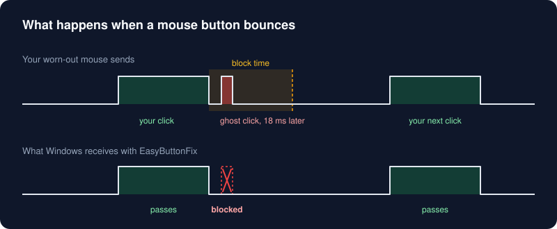

<div align="center">


# EasyButtonFix

### Your mouse double-clicks on its own? Fix it in software, not with a new mouse.

A tiny, free Windows app that blocks the ghost clicks of worn-out mouse buttons.<br>
One click on **Back** goes back one page again. One click stays one click.

[](https://github.com/DimitryVZ/EasyButtonFix/releases/latest)
[](https://github.com/DimitryVZ/EasyButtonFix/releases)
[](#requirements)
[](LICENSE)

<br>

[](https://github.com/DimitryVZ/EasyButtonFix/releases/latest/download/EasyButtonFix-Setup.exe)
&nbsp;
[](https://github.com/DimitryVZ/EasyButtonFix/releases/latest/download/EasyButtonFix-portable.zip)

<sub>Free & open source · No admin rights · No internet · No telemetry</sub>

<br><br>


</div>

<br>

## 🤔 The problem

Mouse switches wear out. After a while they start to **bounce**: when you release the button, the worn contact flickers and sends a second, very short press. You notice it as:

- pressing **Back** once, but the browser jumps back **two pages**
- a single **left click** opening things as if you double-clicked
- drag & drop that randomly lets go

Buying a new mouse fixes it. So does EasyButtonFix, for free, in about a minute.

## ✨ How EasyButtonFix fixes it

<div align="center">

</div>

<br>

A human can't press the same button again a few milliseconds after letting go, but a bouncing switch does exactly that.
EasyButtonFix sits quietly in the tray and ignores any press that arrives within a short **block time** after the same button was released. Real clicks go through untouched.

## 🚀 Features

|  |  |
|---|---|
| 🎯 **Per-button protection** | Back, Forward, Left, Right and Middle button, each with its own on/off switch and block time |
| 🪄 **Auto-calibration** | Press the faulty button 10 times and EasyButtonFix measures how badly it bounces and suggests the right setting |
| 📈 **Live activity** | See every press, the gap in milliseconds and whether it was blocked, so you can verify the fix |
| 🪶 **Featherlight** | ~4 MB download, ~15 MB RAM in the tray. Mouse handling runs on its own thread, so the cursor never lags |
| 🎨 **Modern design** | Native Windows 11 look with dark/light mode and Mica |
| ⚙️ **Set and forget** | Starts with Windows, pause from the tray, settings are saved automatically |
| 🌍 **German & English** | Follows your Windows language, switchable in settings |
| 🔒 **Private** | No internet access, no telemetry, no logging. Open source, so you can check |

## 📦 Installation

1. **[Download the installer](https://github.com/DimitryVZ/EasyButtonFix/releases/latest/download/EasyButtonFix-Setup.exe)** and run it. No admin rights needed.
2. Turn on the button that double-clicks (Back and Forward are on by default).
3. Click **Calibrate**, press the button 10 times and apply the suggestion. Done.

> [!NOTE]
> Windows SmartScreen may say *"Windows protected your PC"* because the app isn't code-signed yet (certificates cost money every year).
> Click **More info → Run anyway**. The full source code is right here if you want to check what it does.

Prefer no installation? Grab the **[portable ZIP](https://github.com/DimitryVZ/EasyButtonFix/releases/latest/download/EasyButtonFix-portable.zip)**, unzip it anywhere and run `EasyButtonFix.exe`.

### Requirements

Windows 10 or 11. That's it: EasyButtonFix uses .NET Framework 4.8, which is already built into Windows.

## ❓ FAQ

<details>
<summary><b>Will it slow down my intentional double clicks?</b></summary>
<br>
No. The block time is measured from <i>releasing</i> the button to the next press. A ghost click comes 5–50 ms after release; a fast human double click takes 80 ms or more. For the left button, keep the block time low (40–60 ms) or let <b>Calibrate</b> pick it for you.
</details>

<details>
<summary><b>Does it work in games?</b></summary>
<br>
Yes, in most games. Windows doesn't let normal apps filter input for programs that run <b>as administrator</b>, and some anti-cheat systems block it too. If that's the case, run EasyButtonFix as administrator as well.
</details>

<details>
<summary><b>Is it safe? Does it record my clicks?</b></summary>
<br>
EasyButtonFix only looks at <i>when</i> a button is pressed, never where or in which app. Nothing is stored except the number of blocked clicks. It has no network code at all. The filter is about 150 lines: <a href="src/EasyButtonFix/Core/MouseFilter.cs"><code>MouseFilter.cs</code></a>.
</details>

<details>
<summary><b>What about macros or remote desktop?</b></summary>
<br>
Clicks generated by software are always passed through untouched. Only physical clicks are filtered.
</details>

<details>
<summary><b>How do I uninstall it?</b></summary>
<br>
<i>Settings → Apps → EasyButtonFix → Uninstall.</i> This removes everything, including the autostart entry and settings.
</details>

## 📝 Changelog

### [1.0.0](https://github.com/DimitryVZ/EasyButtonFix/releases/tag/v1.0.0) · 2026-11-25
First public release: per-button filtering, auto-calibration, live activity, tray mode, autostart, German & English, installer and portable ZIP.

→ Full history in **[CHANGELOG.md](CHANGELOG.md)**

## 🛠️ Build from source

You need Windows and the [.NET SDK 8+](https://dotnet.microsoft.com/download) (or Visual Studio 2022+). For the installer you also need [Inno Setup](https://jrsoftware.org/isinfo.php).

```powershell
git clone https://github.com/DimitryVZ/EasyButtonFix.git
cd EasyButtonFix

# app + installer + portable zip -> .\publish
powershell -ExecutionPolicy Bypass -File .\build.ps1
```

| Where | What |
|---|---|
| `src/EasyButtonFix/Core/MouseFilter.cs` | Low-level mouse hook and the filter logic |
| `src/EasyButtonFix/MainWindow.xaml` | The UI (WPF + [WPF-UI](https://github.com/lepoco/wpfui)) |
| `src/EasyButtonFix/Core/L.cs` | All texts (German / English) |
| `installer/EasyButtonFix.iss` | Inno Setup installer script |

Bug reports and ideas are welcome in [Issues](https://github.com/DimitryVZ/EasyButtonFix/issues).

---

<details>
<summary><b>🇩🇪 Deutsch</b></summary>

<br>

### Deine Maus klickt von selbst doppelt? EasyButtonFix behebt das per Software, statt dass du dir eine neue Maus kaufen musst.

Verschlissene Maustasten „prellen“: Nach dem Loslassen senden sie noch einen zweiten, sehr kurzen Druck. Die Zurück-Taste springt dann zwei Seiten zurück, oder aus einem Klick wird ein Doppelklick.
EasyButtonFix läuft unauffällig im Tray und ignoriert jeden Druck, der nur wenige Millisekunden nach dem Loslassen derselben Taste kommt. Echte Klicks gehen ganz normal durch.

**Funktionen:** Schutz pro Taste · Auto-Kalibrierung · Live-Anzeige · ca. 15 MB RAM · Windows-11-Design · Autostart · Deutsch & Englisch · kein Internet, keine Datensammlung

**Installation:**
1. **[Installer herunterladen](https://github.com/DimitryVZ/EasyButtonFix/releases/latest/download/EasyButtonFix-Setup.exe)** und starten. Es werden keine Admin-Rechte benötigt.
2. Die Taste einschalten, die doppelt klickt (Zurück und Vor sind schon an).
3. Auf **Kalibrieren** klicken, die Taste 10× drücken und den Vorschlag übernehmen.

Falls SmartScreen warnt: **Weitere Informationen → Trotzdem ausführen**. Die App ist nur noch nicht kostenpflichtig signiert.

</details>

<div align="center">
<sub>Made with ❤️ for everyone whose mouse is too good to throw away · <a href="LICENSE">MIT License</a></sub>
</div>
