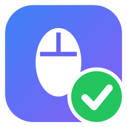
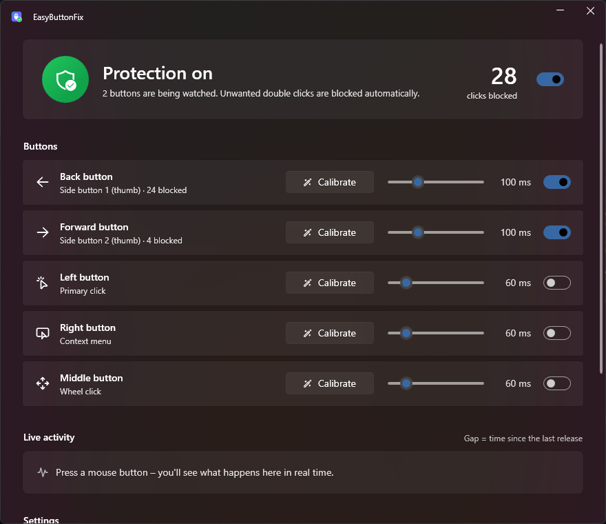

<p align="center">
  
</p>

<h1 align="center">EasyButtonFix</h1>

<p align="center">
  <b>Your mouse double-clicks by itself? Fix it in software instead of buying a new one.</b><br>
  A tiny Windows app that blocks unwanted double clicks caused by worn-out (bouncing) mouse buttons.
</p>

<p align="center">
  <a href="../../releases/latest"><b>⬇ Download</b></a> ·
  <a href="#deutsch">Deutsch</a>
</p>



## Why?

Mouse switches wear out. A typical symptom: you press the **Back** button once and the browser goes back **twice**, or a single left click turns into a double click. The switch "bounces": it sends a second, very short press right after you let go.

EasyButtonFix sits quietly in the tray and ignores any press that arrives within a few milliseconds after the same button was released. Real clicks go through, ghost clicks don't.

## Features

- **Per-button protection**: Back, Forward, Left, Right and Middle, each with its own block time
- **Auto-calibration**: press the button 10 times and EasyButtonFix measures how badly it bounces and suggests the right block time
- **Live activity**: see every press, the gap in ms and whether it was blocked
- **Lightweight**: ~4 MB installer, ~15 MB RAM in the tray, mouse handling on its own thread so the cursor never lags
- **Modern Windows 11 look**: dark/light mode, Mica
- Start with Windows, pause from the tray, German & English
- No installation of runtimes needed (uses .NET Framework 4.8, built into Windows 10/11)
- No admin rights, no internet access, no telemetry

## Install

1. Download `EasyButtonFix-Setup-x.y.z.exe` from the [latest release](../../releases/latest)
   (or the portable ZIP if you don't want to install anything).
2. Run it. Windows SmartScreen may warn about an "unknown publisher" because the app isn't code-signed yet → **More info → Run anyway**.
3. Turn on the button that misbehaves and hit **Calibrate**.

## Limitations

- Doesn't affect windows running **as administrator** (and some games with anti-cheat) unless EasyButtonFix itself runs as administrator. This is a Windows security rule.
- Clicks generated by software (macros, remote desktop) are never touched.

## Build from source

Requirements: Windows, [.NET SDK 8+](https://dotnet.microsoft.com/download) (or Visual Studio 2022+), and [Inno Setup](https://jrsoftware.org/isinfo.php) for the installer.

```powershell
# app only
dotnet build src\EasyButtonFix -c Release

# app + installer + portable zip -> .\publish
powershell -ExecutionPolicy Bypass -File .\build.ps1
```

Open `EasyButtonFix.sln` in Visual Studio to edit the UI (`MainWindow.xaml`).
All UI texts live in `src/EasyButtonFix/Core/L.cs`.

## How it works

A low-level mouse hook (`WH_MOUSE_LL`) runs on a dedicated thread. For every physical button-down it measures the time since that button's last button-up. If it's shorter than the configured block time, the press **and its matching release** are swallowed. Everything else is passed through untouched. See [`MouseFilter.cs`](src/EasyButtonFix/Core/MouseFilter.cs).

---

## Deutsch

**Deine Maus klickt von selbst doppelt? EasyButtonFix behebt das per Software, statt dass du dir eine neue Maus kaufen musst.**

Verschlissene Maustasten „prellen“: Nach dem Loslassen senden sie noch einen zweiten, sehr kurzen Druck. Die Zurück-Taste springt dann zwei Seiten zurück, oder aus einem Klick wird ein Doppelklick. EasyButtonFix läuft unauffällig im Tray und ignoriert jeden Druck, der nur wenige Millisekunden nach dem Loslassen derselben Taste kommt.

- Schutz pro Taste mit eigener Sperrzeit
- **Auto-Kalibrierung**: Taste 10× drücken, die App schlägt die passende Sperrzeit vor
- Live-Anzeige jedes Klicks mit Abstand in ms
- Klein und sparsam, modernes Windows-11-Design, Deutsch & Englisch
- Keine Admin-Rechte, kein Internet, keine Datensammlung

**Installation:** Lade `EasyButtonFix-Setup-x.y.z.exe` aus dem [neuesten Release](../../releases/latest) herunter. Falls SmartScreen warnt: **Weitere Informationen → Trotzdem ausführen**.

## License

[MIT](LICENSE)
